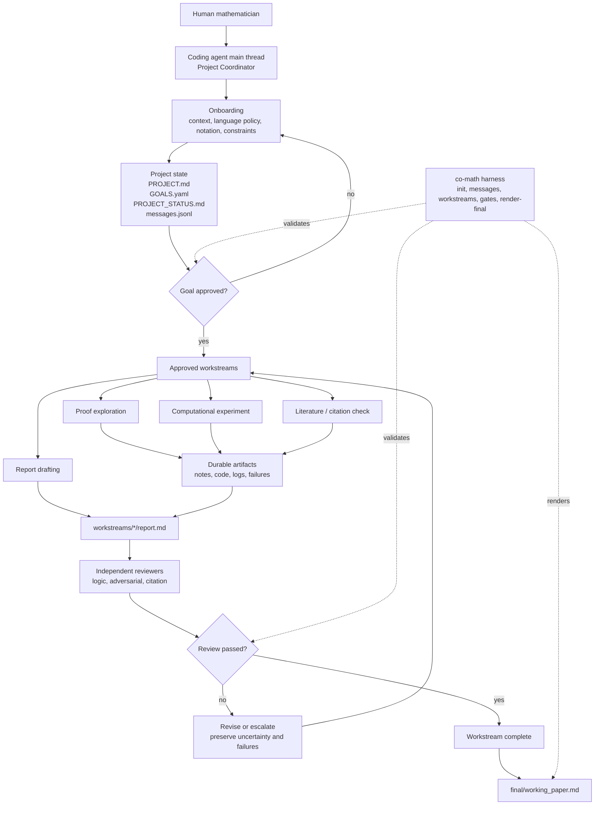

<div align="center">


# Co-Mathematician

Do mathematical research in your coding agent, and read your notes and results in the browser.

[中文说明](README.zh-CN.md) · [Quick Start](#quick-start) · [Architecture](#architecture) · [Full Guide](docs/local-web.md)

 [](https://github.com/VeryMath/co-mathematician) 

</div>

Co-Mathematician (Co-Math) gives each research question its own project. Discuss, compute, and make changes in your coding agent; keep notes and progress in the project folder. Come back later, or start a new chat, and continue from those files.

**The recommended way to install Co-Math is to ask your coding agent.** You do not need to enter each terminal command yourself. The browser is an optional reading view and needs no additional model configuration.

## Inside the Workbench

<p align="center">
  
</p>

The visualizer uses pure white surfaces and neutral black and gray text, with the original VeryMath logo colors. The preview shows a saved note from the existing public math example. No new model request was made for the screenshot.

<a id="web-quick-start"></a>

## Quick Start

Start with a coding agent that is already working and can read and write local files and run commands. Follow these three steps for your first project.

### 1. Send this to your coding agent

```text
Please install Co-Math: https://github.com/VeryMath/co-mathematician
Read the repository instructions, check the required environment, and keep the tool separate from my research projects.
Create a project named "My First Research" in CoMathProjects on my desktop, with research documents in English.
Record the tool location and startup instructions in the project notes so a future session can use them.
Tell me where the research project folder is when ready. Do not start the research yet.
```

You can change the project name, location, and document language. The agent will give you a **research project folder** to work in. Install the tool once; keep each research project in its own folder.

### 2. Open that project folder in your coding agent

Use your tool's "Open folder" or "Open project" action and select the **research project folder** returned above, not the folder containing the Co-Math source code.

The project already includes Co-Math instructions, so you usually do not need to install a Skill separately. If the agent does not recognize the project, ask it to read the directory's `AGENTS.md` first.

### 3. Describe your research question

For example:

```text
Continue this Co-Math project. I want to understand why gradient descent converges.
Help me clarify the question before we choose the next step.
Save useful derivations, calculations, and progress in the project files.
```

You do not need a complete research plan upfront. Ask questions, add materials, and refine the direction as you go.

### Want to read papers and notes? Open the browser view

The browser is optional. When you want it, tell your coding agent:

```text
Please start the Co-Math reading page and tell me its address and which project folder to open.
```

Open the returned address, click "Open project," and choose the same research project. Read papers, formulas, notes, and progress there. Saved file changes update the page, with a manual refresh control when needed.

Keep research tasks and conversations in your coding agent; use the browser for reading. **No separate API key is needed for the page.**

### Come back later or start another project

- **Continue a project:** reopen its folder in your coding agent and say, "Continue this Co-Math project. First check where we left off." No reinstall is needed.
- **Start another project:** say, "Keep this project and create a separate Co-Math project for [new topic]. Tell me its folder location, without starting the research yet." Then open the new folder.
- **Update the tool:** ask your agent to update Co-Math while preserving your existing research projects.

<details>
<summary>Alternative: install manually in a terminal</summary>

Use the commands below if you prefer manual setup. The basic installation requires **Git and Python 3.10+**. The optional browser view also requires **Node.js 22.19+**.

**macOS / Linux**

```bash
git clone https://github.com/VeryMath/co-mathematician.git
cd co-mathematician
python3 -m venv .venv
source .venv/bin/activate
python -m pip install -e .
co-math setup --projects-home "$HOME/Desktop/CoMathProjects"
co-math new "My First Research"
```

Open the returned research project folder in your coding agent. To add the browser view, continue in the tool's source directory:

```bash
npm install --package-lock=false
npm run build
CO_MATH_PYTHON=python npm start
```

**Windows PowerShell** (not fully verified)

```powershell
git clone https://github.com/VeryMath/co-mathematician.git
cd co-mathematician
py -3 -m venv .venv
.\.venv\Scripts\python.exe -m pip install -e .
.\.venv\Scripts\co-math.exe setup --projects-home "$HOME\Desktop\CoMathProjects"
.\.venv\Scripts\co-math.exe new "My First Research"
```

To add the browser view:

```powershell
npm install --package-lock=false
npm run build
$env:CO_MATH_PYTHON = (Resolve-Path .\.venv\Scripts\python.exe).Path
npm start
```

The default address is [http://127.0.0.1:4175](http://127.0.0.1:4175). Keep the process running while you read. For later starts, return to the tool's source directory and use the same Python environment.

These commands put new projects in `CoMathProjects` on your desktop. Without a configured project location, the default is `~/CoMathProjects`; existing projects are not moved automatically.

After manual setup, ask the agent to record the tool directory and Python environment in your project notes so future sessions can find the command. See the [full guide](docs/local-web.md) for startup and reading details.

</details>

## Current Capabilities and Limits

| Feature | Available in this release |
| --- | --- |
| Projects | Open existing projects, read structured goals, and access project details |
| Files | Directory browsing, project-wide filename search, notes and materials, original-file downloads |
| Materials | Read PDF, Word (`.docx`), Markdown, TXT, LaTeX, CSV, JSON/YAML, Python, Lean, and BibTeX saved in the project; up to 10 MB per file |
| Formulas | Math in Markdown, TXT, LaTeX, research goals, and historical conversations; common native Word equations; reading/source views |
| PDF | Original pages, page navigation, extracted text, and original-file downloads |
| Conversations | Read-only access to historical web conversations already saved in the project |
| Skills | Read project-local methods; use the Co-Math and domain Skills in your coding agent |
| Updates | Refresh after saved file changes, with a manual refresh fallback |
| Interface | Pure white surfaces, neutral black and gray text, VeryMath branding, and resizable panels |

Text formulas need `$…$`, `$$…$$`, `\(...\)`, or `\[…\]` delimiters, for example `The gradient is $\nabla f(x)$`. Ordinary prose is not guessed to be math. LaTeX support is a formula preview, not a full document compiler; use the compiled PDF for complete typesetting. Unsupported formulas keep their source or receive a notice to check the original. **OCR and image-equation recognition are not included.**

Skills guide work in your coding agent, where commands, computation, and review are carried out using that agent's available tools. The web page can display their saved files. See [Skill integration](docs/skills-integration.md) for the shared project workflow.

The visualizer does not run research or call a model service. Displaying a note, a completed status, or a historical answer does not verify a mathematical claim; independent review remains part of the coding-agent workflow.

## Where Projects and Data Are Saved

`co-math new` prints the project location. The standard layout is:

```text
your-project/
├── co-math.toml
├── AGENTS.md                       # Instructions for your coding agent
├── CLAUDE.md                       # Pointer to the same instructions
├── .agents/skills/                 # Project-local research methods
├── workspace/
│   ├── project/
│   │   ├── PROJECT.md              # Project overview
│   │   ├── GOALS.yaml              # Research question and goals
│   │   ├── PROJECT_STATUS.md       # Progress, open questions, next action
│   │   ├── messages.jsonl          # Saved project messages
│   │   ├── materials/              # Materials added as needed
│   │   └── notes/                  # Notes saved as needed
│   ├── workstreams/                # Proofs, computation, reports, reviews
│   └── final/                      # Working paper and other final files
└── .co-math/web/conversation.json   # Historical web conversation, if present
```

The coding agent creates materials and notes folders as needed. The opened-project list is kept in `web-projects.json` under `~/.config/co-math/` by default. The visualizer reads local project files; it does not require credentials or send them to a model service.

**Private conversations in external coding agents are not automatically synchronized.** Ask the agent to save useful notes, results, and progress in the project. The browser displays those files and any historical web conversation already present; it cannot reconstruct an agent's private chat from file changes. See the [visualizer guide](docs/local-web.md) for data locations and refresh behavior.

## Version Updates

### Project visualization (2026-10-19)

- research, dialogue, and project creation use the existing Co-Math Skill and CLI in any coding agent
- the web page opens existing projects and focuses on file browsing, search, goals, notes, materials, PDF/LaTeX reading, and downloads
- compact project details and read-only historical web conversations remain accessible
- saved file changes refresh the view, with a manual fallback
- no web model configuration, new chat, new notes, uploads, or new projects; no Pi runtime or API key is needed

<details>
<summary>Past features: 2026-10-18, 0.3.0, and earlier</summary>

The entries below describe earlier releases. Their web chat, model configuration, uploads, and creation controls are not part of the current visualizer.

### Main branch updates (2026-10-18)

- added project continuation summaries and copyable coding-agent handoffs using existing notes and recent discussion
- added PDF page and text paragraph selections with accurate preview and transmitted scope
- added directory browsing, project-wide filename search, and pagination beyond the previous 1,500-file cutoff
- switched the workbench to white surfaces and neutral text, retaining the original logo colors

### 0.3.0 (2026-09-26)

- added the local web workbench with project creation and folder browsing
- added independent model-service profiles, model switching, streaming, cancellation, and saved conversations
- added material imports, PDF original-page reading, formula previews, and saved research notes
- added local VeryMath Skill guidance, readable research goals, and resizable panels
- retained the existing CLI and project layout

### 0.2.0 (2026-08-29)

- added independent, long-lived project directories with optional Git repositories
- added one canonical project Skill under `.agents/skills/` for coding agents
- added `setup`, `new`, `list`, `status`, `resume`, `next`, `archive`, and `reopen`
- kept the harness focused on project files, research state, reviews, and working papers

### 0.1.0

- introduced the repository-backed research workspace, approved goals,
  workstreams, independent review, and final working-paper flow

</details>

<a id="architecture"></a>

## Research Architecture

<p align="center">
  
</p>
<p align="center">
  From problem clarification to independent review and research outputs. Your coding agent drives the work; the web page reads the saved project files.
</p>

The CLI workflow, role definitions, and platform adapters remain below. The web page provides a reading view of their saved files.

## Install And Create Projects

<details>
<summary>CLI installation, research workflow, and agent integrations</summary>

This section documents the commands and project structure used by the agent. For a first installation, follow the [quick start](#quick-start) above; you do not need to install again.

Choose the parent directory for your projects. If you skip this command,
Co-Math uses `~/CoMathProjects`.

```bash
co-math setup --projects-home ~/CoMathProjects
```

Create the first project:

```bash
co-math new "Muon Convergence"
```

The command prints the new path. Open that directory in your coding agent, then
say:

```text
Continue this Co-Math project.
```

Every created project contains:

```text
co-math.toml
AGENTS.md
CLAUDE.md
.agents/skills/co-mathematician/SKILL.md
workspace/
```

`.agents/skills/` is the canonical Skill location. Coding agents that support
Agent Skills discover it directly. `AGENTS.md` is the general entry point, and
the short `CLAUDE.md` points Claude Code to the same instructions. There is no
separate Co-Math workflow for each coding agent.

### Daily Project Flow

```bash
co-math list
co-math resume --project ~/CoMathProjects/Muon\ Convergence
co-math next --project ~/CoMathProjects/Muon\ Convergence
co-math archive --project ~/CoMathProjects/Muon\ Convergence
co-math reopen --project ~/CoMathProjects/Muon\ Convergence
```

When project A is finished, archive it and run `co-math new "Project B"`.
Project B receives a new directory, workspace, Skill, and Git repository; no
files from project A are cleared or reused.

### Core Repository Workspace

The checked-in `workspace/` remains available for developing Co-Math itself and
for backward compatibility:

```bash
co-math init --workspace workspace
PYTHONPATH=. python3 -m harness.co_math.cli --help
```

### Project-Local Skills

For AI4Math skill libraries and project-specific research workflows, install
skills into this repository by default:

```text
.agents/skills/
```

The registry scanner discovers both `.agents/skills/<skill>/SKILL.md` and nested
layouts such as `.agents/skills/<category>/<skill>/SKILL.md`.

Use global skill roots such as `~/.codex/skills` or `~/.agents/skills` only when
you intentionally want a personal installation shared across projects.

For example, to bring a local AI4Math skill library into this workspace:

```bash
mkdir -p .agents/skills
rsync -a /path/to/AI4Math-Skill-Library/skills/ .agents/skills/
co-math refresh-skills --workspace workspace
co-math suggest-skills --workspace workspace --query "Stiefel manifold optimization"
```

`suggest-skills` refreshes the project-local registry by default, so newly copied
skills are visible to the workspace even when the coding agent's native skill
registry has not reloaded yet. If it suggests a relevant skill, ask the Project
Coordinator to read that `SKILL.md` before proposing goals or creating a
workstream.

If the user chooses to let that Skill drive the task, record a handoff:

```bash
co-math skill-handoff \
  --workspace workspace \
  --skill optimization-skill \
  --mode skill_guided \
  --reason "The task is an optimization modeling problem." \
  --query "Stiefel manifold optimization" \
  --skill-path ".agents/skills/optimization-skill/SKILL.md"
```

After handoff, follow the domain Skill's workflow for the inner task. Use the
full goal/workstream/reviewer flow only when the user wants durable research
output or a final working paper.

## First Interaction

After opening a created project directory in your coding agent, start with:

```text
Continue this Co-Math project. Read AGENTS.md and the Co-Mathematician Skill,
run `co-math resume --project .`, and guide me through onboarding.
Do not start concrete research yet.
```

The first onboarding choice should be the workspace document language policy:

1. English for all workspace documents.
2. User language for research notes, English for schemas, gates, and reviews.
3. User language for all human-readable research documents.
4. Match each project or conversation.

## Starting A Research Project

Give the agent your problem context only after onboarding starts:

```text
I want to start a mathematical research project.

Problem context:
...

Known definitions, notation, and constraints:
...

Relevant references or files:
...

Please formalize the research question and propose goals.
Do not create workstreams yet.
```

If a domain Skill is explicitly invoked, the interaction may enter
skill-guided mode instead. In that case, the Skill's own opening, modeling, and
approval rules control the next steps. Co-Mathematician records the handoff and
keeps provenance, uncertainty, failures, and final-paper gates available when
the user promotes the task into a research project.

The Project Coordinator should update:

```text
workspace/project/PROJECT.md
workspace/project/GOALS.yaml
workspace/project/PROJECT_STATUS.md
workspace/project/messages.jsonl
```

Draft goals are not executable. A goal can receive workstreams only when its
status is:

```yaml
status: approved
```

Check a goal gate:

```bash
co-math check-gate --workspace workspace --gate goal_approval --goal-id G1
```

Approve goals in chat with a clear instruction:

```text
I approve goal G1 as written.
You may create workstreams for G1.
```

## Creating Workstreams

After goal approval, ask the Project Coordinator to create focused workstreams:

```text
Create a literature workstream for approved goal G1.
The workstream should identify relevant known results, exact theorem
statements, assumptions, and citation provenance.
```

or:

```text
Create a proof exploration workstream for approved goal G1.
Preserve failed attempts and expose unresolved uncertainty in the report.
```

The harness command is:

```bash
co-math new-workstream \
  --workspace workspace \
  --goal-id G1 \
  --title "Literature baseline review" \
  --kind literature
```

Allowed workstream kinds are `proof`, `computation`, `literature`, and `review`.

To reuse an upstream file, add `--input <workspace-relative-path>` to the
command, once per file. The workstream records relative links in `inputs.md`
and reads the existing files in place. Keep shared inputs unchanged and save
new outputs under the new workstream's `artifacts/` directory. See
[reusing workstream inputs](docs/artifact-reuse.md) for examples and existing
project guidance.

Each workstream should produce a report with:

- provenance for important claims
- explicit uncertainty
- failed explorations
- independent reviewer output under `reviews/`

Check completion:

```bash
co-math check-gate \
  --workspace workspace \
  --gate workstream_completion \
  --workstream-id WS-G1-001-example
```

## Rendering The Working Paper

When workstream reports pass independent review, render the final working paper:

```bash
co-math render-final --workspace workspace
```

The output is:

```text
workspace/final/working_paper.md
```

This is a working paper, not a chat summary. It should preserve provenance,
uncertainty, failed explorations, and reviewer status.

An existing `working_paper.md` is preserved by default. Use
`co-math render-final --workspace workspace --overwrite` only when you intend
to replace it with a newly rendered paper.

## Workspace Framework

The diagram below describes the external coding-agent workflow. The web workbench shares its project files, but does not execute these agents or reviews.



## Harness Commands

```bash
co-math setup --projects-home ~/CoMathProjects
co-math new "Project Name"
co-math list
co-math status --project /path/to/project
co-math resume --project /path/to/project
co-math next --project /path/to/project
co-math archive --project /path/to/project
co-math reopen --project /path/to/project
co-math init --workspace workspace
co-math refresh-skills --workspace workspace
co-math suggest-skills --workspace workspace --query "..."
co-math skill-handoff --workspace workspace --skill optimization-skill --mode skill_guided --reason "..." --query "..."
co-math append-message --workspace workspace --sender project_coordinator --recipient user --type status --content "..."
co-math new-workstream --workspace workspace --goal-id G1 --title "..." --kind proof
co-math check-gate --workspace workspace --gate goal_approval --goal-id G1
co-math check-gate --workspace workspace --gate workstream_completion --workstream-id WS-G1-001-example
co-math render-final --workspace workspace
```

## Coding-Agent Compatibility

Created projects use one standard Skill and one command. Platform-specific
files in the Core repository are only development adapters:

```text
agents/roles/       canonical, platform-neutral role cards
.codex/agents/      Codex TOML adapters
.claude/agents/     Claude Code Markdown subagent adapters
.cursor/rules/      Cursor project-rule adapters
```

| Coding agent | Created project entry | Optional Core development adapter |
| --- | --- | --- |
| Generic repository-aware agent | `AGENTS.md`, `.agents/skills/co-mathematician/SKILL.md` | none |
| Codex | same standard files | `.codex/` |
| Claude Code | `CLAUDE.md` points to the standard files | `.claude/` |
| Cursor or OpenCode | same standard files | no adapter required for project lifecycle |

If your coding-agent environment has no native subagent feature, use a fresh
reviewer prompt or a separate session and save the review under the workstream
`reviews/` directory.

## Created Project Layout

```text
co-math.toml
AGENTS.md
CLAUDE.md
.agents/skills/co-mathematician/
workspace/
```

</details>

## Source Checks

```bash
PYTHONDONTWRITEBYTECODE=1 PYTHONPATH=. python3 -m harness.co_math.cli --help
python3 -m pip wheel --no-deps --no-build-isolation .
npm run check
npm run build
```

## Inspiration and License

This project draws on public design principles from Google DeepMind's [AI Co-Mathematician paper](https://arxiv.org/abs/2605.06651). It is not a reproduction of that system.

MIT. See `LICENSE`. Bundled brand and PDF assets retain their original licenses; see [third-party assets](docs/third-party-assets.md).
