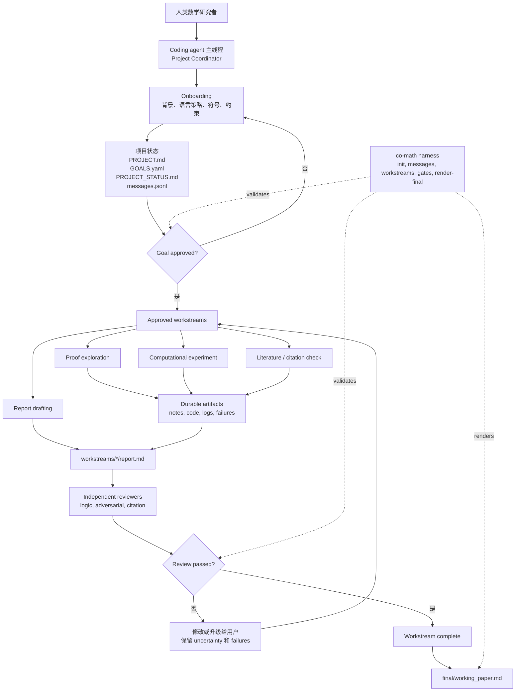

<div align="center">


# Co-Mathematician

用你熟悉的 coding agent 做数学研究，在网页里查看笔记和结果。

[English](README.md) · [快速开始](#quick-start) · [架构](#architecture) · [完整使用说明](docs/local-web.md)

 [](https://github.com/VeryMath/co-mathematician) 

</div>

Co-Mathematician（简称 Co-Math）帮你把一个研究问题保存为独立项目。你在 coding agent 中讨论、计算和修改，笔记与进展留在项目文件夹里。过几天回来，或换一个会话，仍能接着做。

**推荐让 coding agent 帮你安装。** 你不必自己逐条输入终端命令。网页是可选的阅读界面，不需要额外配置模型。

## 工作台一览

<p align="center">
  
</p>

页面采用纯白底色和黑灰文字，仅 VeryMath 品牌标志保留原色。预览图展示已有公开数学示例中的研究笔记，截图过程中没有发起模型请求。

<a id="quick-start"></a>
<a id="网页版快速开始"></a>

## 快速开始

准备一个能读写本机文件、执行命令的 coding agent，并确保它已能正常使用。第一次使用按下面三步操作即可。

### 1. 把这段话发给 coding agent

```text
请帮我安装 Co-Math：https://github.com/VeryMath/co-mathematician
先阅读仓库说明，检查所需环境，把工具和研究项目分开放置。
在桌面的 CoMathProjects 文件夹中新建“我的第一个研究”，研究文档使用中文。
把工具安装位置和启动方法记入项目说明，方便下次继续使用。
完成后告诉我研究项目的文件夹位置，现在不要开始研究。
```

项目名称和保存位置都可以换成你喜欢的。安装完成后，agent 会给出一个**研究项目文件夹**，以后就在这个文件夹中工作。工具只需安装一次，每个研究项目使用独立的文件夹。

### 2. 在 coding agent 中打开这个项目文件夹

在你使用的工具里选择“打开文件夹”或“打开项目”，选中刚才返回的**研究项目文件夹**，不是下载 Co-Math 源码的文件夹。

项目已附带 Co-Math 的使用说明，通常不必再手动安装 Skill。如果 agent 没有识别项目，可以提醒它：“请先读取这个目录的 AGENTS.md。”

### 3. 说出你想研究的问题

例如：

```text
继续这个 Co-Math 项目。我想研究梯度下降为什么会收敛。
请先和我澄清问题，再一起确定下一步。
把有用的推导、计算结果和进展保存到项目文件中。
```

不必一开始就写出完整的研究计划。你可以像平时一样提问、补充材料和纠正方向。

### 想看论文和笔记？打开阅读网页

网页是可选的。需要时，在 coding agent 中说：

```text
请帮我启动 Co-Math 阅读网页，告诉我访问地址和应打开的项目文件夹。
```

打开 agent 给出的地址，点击“打开项目”，选择同一个研究项目。你可以阅读论文、公式、笔记和进展；agent 保存文件后，页面会更新，也可以手动刷新。

研究任务和对话继续在 coding agent 中完成，网页只负责查看。**无需为网页另填 API Key。**

### 下次继续，或者开始新项目

- **继续原项目：** 在 coding agent 中重新打开同一个项目文件夹，说“继续这个 Co-Math 项目，先看看上次做到哪里了”。不必重新安装。
- **开始新项目：** 说“保留当前项目，为‘新的研究题目’创建另一个 Co-Math 项目，告诉我新文件夹的位置，先不要开始研究”。然后打开新的项目文件夹。
- **更新工具：** 让 agent 更新 Co-Math 工具本身，并保留已有研究项目。

<details>
<summary>备选：自己用终端安装</summary>

如果偏好手动操作，可以使用下面的命令。基础安装需要 **Git 和 Python 3.10+**；使用阅读网页还需要 **Node.js 22.19+**。

**macOS / Linux**

```bash
git clone https://github.com/VeryMath/co-mathematician.git
cd co-mathematician
python3 -m venv .venv
source .venv/bin/activate
python -m pip install -e .
co-math setup --projects-home "$HOME/Desktop/CoMathProjects"
co-math new "我的第一个研究"
```

用 coding agent 打开命令返回的研究项目目录。若还需要阅读网页，在工具源码目录继续运行：

```bash
npm install --package-lock=false
npm run build
CO_MATH_PYTHON=python npm start
```

**Windows PowerShell**（尚未完整验证）

```powershell
git clone https://github.com/VeryMath/co-mathematician.git
cd co-mathematician
py -3 -m venv .venv
.\.venv\Scripts\python.exe -m pip install -e .
.\.venv\Scripts\co-math.exe setup --projects-home "$HOME\Desktop\CoMathProjects"
.\.venv\Scripts\co-math.exe new "我的第一个研究"
```

使用阅读网页时，再运行：

```powershell
npm install --package-lock=false
npm run build
$env:CO_MATH_PYTHON = (Resolve-Path .\.venv\Scripts\python.exe).Path
npm start
```

网页默认地址为 [http://127.0.0.1:4175](http://127.0.0.1:4175)，启动它的进程需要保持运行。再次启动时，回到工具源码目录并使用同一个 Python 环境。

上面的命令把新项目放在桌面的 `CoMathProjects` 文件夹。未设置项目位置时，默认使用 `~/CoMathProjects`；已有项目不会自动移动。

手动安装后，也建议让 agent 把工具目录和 Python 环境位置记入研究项目说明，避免换会话后找不到命令。更多启动与阅读说明见[使用文档](docs/local-web.md)。

</details>

## 当前能力与限制

| 功能 | 本版支持 |
| --- | --- |
| 项目 | 打开已有项目、阅读研究目标、查看项目详情 |
| 文件 | 按目录浏览、在项目中搜索文件名、阅读笔记和材料、下载原文件 |
| 材料 | 阅读项目内的 PDF、Word（`.docx`）、Markdown、TXT、LaTeX、CSV、JSON/YAML、Python、Lean 和 BibTeX；单个文件最多 10 MB |
| 公式 | Markdown、TXT、LaTeX、研究目标和历史对话的公式排版；Word 常见原生公式；“阅读 / 源文”切换 |
| PDF | 原始页面阅读、翻页、提取文字和下载原文件 |
| 对话 | 只读查看项目中已保存的历史网页对话 |
| Skill | 阅读项目级方法说明；在 coding agent 中使用 Co-Math 和领域 Skill |
| 更新 | 保存文件后刷新显示，保留手动刷新入口 |
| 界面 | 纯白底色、中性黑灰文字、VeryMath 品牌和可拖动分栏 |

文本公式须使用 `$…$`、`$$…$$`、`\(...\)` 或 `\[…\]` 标记，例如 `梯度为 $\nabla f(x)$`。普通文字不会被猜测成公式。LaTeX 是公式预览，完整论文排版仍以编译后的 PDF 为准；不支持的公式会保留原式或提示对照原文件。**没有扫描文字或图片公式识别。**

Skill 在 coding agent 中指导研究，由 agent 使用其可用工具执行命令、计算与审查，网页展示保存下来的文件。用法见 [Skill 接入说明](docs/skills-integration.md)。

网页不执行研究，也不请求模型服务。显示笔记、完成状态或历史回答不代表数学结论已验证；独立审查仍由 coding agent 的研究流程负责。

## 项目与数据保存在哪里

`co-math new` 会返回项目位置。标准目录如下：

```text
你的项目/
├── co-math.toml
├── AGENTS.md                       # coding agent 的项目说明
├── CLAUDE.md                       # 指向同一套说明
├── .agents/skills/                 # 项目自己的研究方法
├── workspace/
│   ├── project/
│   │   ├── PROJECT.md              # 项目说明
│   │   ├── GOALS.yaml              # 研究问题和目标
│   │   ├── PROJECT_STATUS.md       # 进展、未解决问题和下一步
│   │   ├── messages.jsonl          # 保存的项目消息
│   │   ├── materials/              # 按需添加的研究材料
│   │   └── notes/                  # 按需保存的研究笔记
│   ├── workstreams/                # 证明、计算、报告和审查
│   └── final/                      # 研究稿及其他最终文件
└── .co-math/web/conversation.json   # 历史网页对话，可能不存在
```

材料和笔记目录由 coding agent 按需创建。已打开项目列表默认保存在 `~/.config/co-math/web-projects.json`。网页读取本机项目文件，不需要密钥，也不会把它们发送给模型服务。

**外部 coding agent 的私有对话不会自动同步。** 请让 agent 把有用的笔记、结果和进展保存到项目。网页展示这些文件，以及项目中已有的历史网页对话；文件更新不会让网页获得 agent 的私有聊天。数据位置与刷新说明见[网页使用说明](docs/local-web.md)。

## 版本更新

### 项目可视化（2026-10-19）

- 研究、对话和项目创建统一在任意 coding agent 中通过现有 Co-Math Skill 与 CLI 完成
- 网页打开已有项目，集中展示目录、搜索、目标、笔记、材料、PDF、LaTeX 和原文件下载
- 简要项目详情和历史网页对话继续可读，历史对话仅供查看
- 保存文件后刷新显示，保留手动刷新作为补充
- 网页不再提供模型配置、新对话、新笔记、上传或新建项目，不加载 Pi 运行时，也不需要 API Key

<details>
<summary>历史功能：2026-10-18、0.3.0 及更早版本</summary>

以下记录描述过去版本。网页聊天、模型配置、上传和创建入口不属于当前可视化页面。

### main 分支更新（2026-10-18）

- 新增项目接续摘要及可复制的 coding agent 提示，关联已有笔记和最近讨论
- 支持指定 PDF 页码或正文段落，区分预览范围与实际发送范围
- 材料栏按目录加载，支持整个项目的文件名搜索和分页，不再限于前 1,500 个文件
- 工作台统一为纯白底色和黑灰文字，仅品牌标志保留原色

### 0.3.0 (2026-09-26)

- 新增本地研究工作台，支持创建项目、浏览文件夹和继续研究
- 新增独立模型服务配置、模型切换、流式回答、停止与对话保存
- 新增材料导入、PDF 原文阅读、公式预览与研究笔记保存
- 新增本机 VeryMath Skill 流程指导、可读研究目标与可拖动分栏
- 保留原有命令行和项目文件布局

### 0.2.0 (2026-08-29)

- 支持独立、可长期维护的项目目录和可选 Git 仓库
- 在 `.agents/skills/` 提供一份供 coding agent 使用的项目级 Skill
- 新增 `setup`、`new`、`list`、`status`、`resume`、`next`、`archive` 和 `reopen`
- harness 继续只管理项目文件、研究状态、审查和 working paper

### 0.1.0

- 建立仓库化研究工作区、目标批准、workstream、独立审查和最终 working paper 流程

</details>

<a id="architecture"></a>

## 研究架构

<p align="center">
  
</p>
<p align="center">
  从问题澄清到独立审查与研究成果。coding agent 执行研究，网页阅读保存下来的项目文件。
</p>

下面保留命令行研究流程、角色定义和平台适配说明。网页为项目提供阅读界面，研究仍由 coding agent 完成。

## 安装并创建项目

<details>
<summary>展开命令行安装、研究流程与平台适配</summary>

以下是 agent 使用的命令和项目结构，供需要了解细节时查阅。首次使用请先看上方[快速开始](#quick-start)，无需重复安装。

指定所有数学项目的父目录。不执行这一步时，默认使用 `~/CoMathProjects`。

```bash
co-math setup --projects-home ~/CoMathProjects
```

创建第一个项目：

```bash
co-math new "Muon Convergence"
```

命令会返回新项目路径。用任意 coding agent 打开该目录，然后说：

```text
继续这个 Co-Math 项目。
```

每个新项目都包含：

```text
co-math.toml
AGENTS.md
CLAUDE.md
.agents/skills/co-mathematician/SKILL.md
workspace/
```

`.agents/skills/` 是唯一完整 Skill 的位置。支持 Agent Skills 的 coding agent 会
直接发现它；`AGENTS.md` 是通用入口，简短的 `CLAUDE.md` 让 Claude Code 指向同一
份说明。Co-Math 不为不同 coding agent 维护多套工作流。

### 日常项目流程

```bash
co-math list
co-math resume --project ~/CoMathProjects/Muon\ Convergence
co-math next --project ~/CoMathProjects/Muon\ Convergence
co-math archive --project ~/CoMathProjects/Muon\ Convergence
co-math reopen --project ~/CoMathProjects/Muon\ Convergence
```

项目 A 完成后先归档，再运行 `co-math new "Project B"`。项目 B 会得到新的目录、
workspace、Skill 和 Git 仓库，不会清空或复用项目 A 的研究文件。

### Core 仓库内工作区

仓库自带的 `workspace/` 继续用于开发 Co-Math 本身和兼容旧流程：

```bash
co-math init --workspace workspace
PYTHONPATH=. python3 -m harness.co_math.cli --help
```

### 项目级 Skills

为了兼容 AI4Math 的大量 skill libraries 和项目特定研究流程，默认把 skills
安装或复制到当前仓库：

```text
.agents/skills/
```

registry scanner 会发现 `.agents/skills/<skill>/SKILL.md`，也会发现类似
`.agents/skills/<category>/<skill>/SKILL.md` 的嵌套布局。

只有当你明确想要“跨项目共享的个人安装”时，才使用 `~/.codex/skills` 或
`~/.agents/skills` 这样的全局 skill root。

例如，把本地 AI4Math skill library 放进这个工作区：

```bash
mkdir -p .agents/skills
rsync -a /path/to/AI4Math-Skill-Library/skills/ .agents/skills/
co-math refresh-skills --workspace workspace
co-math suggest-skills --workspace workspace --query "Stiefel manifold optimization"
```

`suggest-skills` 默认会先刷新项目级 registry，所以即使 coding agent 的原生 skill
registry 还没重新加载，新复制进来的 skills 也会被工作区看见。如果它推荐了相关
skill，就要求 Project Coordinator 在提出 goals 或创建 workstream 前先阅读对应的
`SKILL.md`。

如果用户决定让这个 Skill 接管内部任务流程，就记录 handoff：

```bash
co-math skill-handoff \
  --workspace workspace \
  --skill optimization-skill \
  --mode skill_guided \
  --reason "The task is an optimization modeling problem." \
  --query "Stiefel manifold optimization" \
  --skill-path ".agents/skills/optimization-skill/SKILL.md"
```

handoff 之后，内部步骤按 domain Skill 自己的流程走。只有当用户希望把任务提升为
durable research output 或 final working paper 时，才进入完整的
goal/workstream/reviewer 流程。

## 第一次交互

用 coding agent 打开新建的项目目录后，可以直接说：

```text
继续这个 Co-Math 项目。请读取 AGENTS.md 和 Co-Mathematician Skill，
运行 `co-math resume --project .`，然后带我完成 onboarding。
现在不要开始具体研究。
```

onboarding 的第一个偏好问题应该是文档语言策略：

1. 所有 workspace documents 都用英文。
2. research notes 用用户语言，schemas、gates、reviews 用英文。
3. 所有人类可读 research documents 都用用户语言。
4. 跟随每个 project 或 conversation 的语言。

## 开始一个数学研究项目

onboarding 开始后，再把问题背景给 agent：

```text
我想开始一个数学研究项目。

问题背景：
...

已知定义、符号和约束：
...

相关文献、文件或上下文：
...

请先 formalize research question，并提出 proposed goals。
现在不要创建 workstreams。
```

如果用户明确调用了某个 domain Skill，也可以进入 skill-guided mode。此时下一步
由该 Skill 自己的 opening、modeling 和 approval rules 控制；Co-Mathematician
只记录 handoff，并在任务被提升为研究项目时继续提供 provenance、uncertainty、
failures 和 final-paper gates。

Project Coordinator 应更新：

```text
workspace/project/PROJECT.md
workspace/project/GOALS.yaml
workspace/project/PROJECT_STATUS.md
workspace/project/messages.jsonl
```

draft goal 不可执行。只有当 goal 状态是下面这样，才能启动 workstream：

```yaml
status: approved
```

检查 goal gate：

```bash
co-math check-gate --workspace workspace --gate goal_approval --goal-id G1
```

在对话里明确 approve：

```text
我批准 goal G1，按当前写法执行。
你现在可以为 G1 创建 workstreams。
```

## 创建 Workstreams

goal approval 之后，再让 Project Coordinator 创建聚焦的 workstreams：

```text
请为已批准的 goal G1 创建一个 literature workstream。
这个 workstream 需要找出相关已知结果、精确的 theorem statements、
适用假设，以及 citation provenance。
```

或者：

```text
请为已批准的 goal G1 创建一个 proof exploration workstream。
请保存失败尝试，并在 report 中显式暴露 unresolved uncertainty。
```

harness 命令是：

```bash
co-math new-workstream \
  --workspace workspace \
  --goal-id G1 \
  --title "Literature baseline review" \
  --kind literature
```

允许的 workstream kind 是 `proof`、`computation`、`literature` 和 `review`。

需要复用上游文件时，为命令添加 `--input <相对于 workspace 的路径>`，多个文件可
重复添加。新 workstream 会在 `inputs.md` 记录相对链接，直接读取已有文件。
共享输入保持不变，新输出放在当前 workstream 的 `artifacts/` 下。示例和已有项目的
处理方式见[输入文件复用说明](docs/artifact-reuse.zh-CN.md)。

每个 workstream report 应包含：

- 重要 claims 的 provenance
- 显式 uncertainty
- failed explorations
- `reviews/` 下的独立 reviewer output

检查 completion：

```bash
co-math check-gate \
  --workspace workspace \
  --gate workstream_completion \
  --workstream-id WS-G1-001-example
```

## 渲染 Working Paper

当 workstream reports 通过独立审查后，渲染 final working paper：

```bash
co-math render-final --workspace workspace
```

输出位置是：

```text
workspace/final/working_paper.md
```

这是 working paper，不是聊天总结。它应该保留 provenance、uncertainty、
failed explorations 和 reviewer status。

已有的 `working_paper.md` 默认会保留。只有明确需要替换时，才运行
`co-math render-final --workspace workspace --overwrite`。

## 工作区框架

下图描述由外部 coding agent 驱动的研究流程。网页版共用项目文件，但不会自动执行图中的 agent 或审稿步骤。



## Harness 命令

```bash
co-math setup --projects-home ~/CoMathProjects
co-math new "Project Name"
co-math list
co-math status --project /path/to/project
co-math resume --project /path/to/project
co-math next --project /path/to/project
co-math archive --project /path/to/project
co-math reopen --project /path/to/project
co-math init --workspace workspace
co-math refresh-skills --workspace workspace
co-math suggest-skills --workspace workspace --query "..."
co-math skill-handoff --workspace workspace --skill optimization-skill --mode skill_guided --reason "..." --query "..."
co-math append-message --workspace workspace --sender project_coordinator --recipient user --type status --content "..."
co-math new-workstream --workspace workspace --goal-id G1 --title "..." --kind proof
co-math check-gate --workspace workspace --gate goal_approval --goal-id G1
co-math check-gate --workspace workspace --gate workstream_completion --workstream-id WS-G1-001-example
co-math render-final --workspace workspace
```

## Coding Agent 兼容性

新建项目只使用一个标准 Skill 和一套命令。Core 仓库内的平台文件仅用于开发：

```text
agents/roles/       canonical, platform-neutral role cards
.codex/agents/      Codex TOML adapters
.claude/agents/     Claude Code Markdown subagent adapters
.cursor/rules/      Cursor project-rule adapters
```

| Coding agent | 新建项目入口 | 可选 Core 开发适配 |
| --- | --- | --- |
| 通用 repository-aware agent | `AGENTS.md`、`.agents/skills/co-mathematician/SKILL.md` | 不需要 |
| Codex | 同一套标准文件 | `.codex/` |
| Claude Code | `CLAUDE.md` 指向标准文件 | `.claude/` |
| Cursor 或 OpenCode | 同一套标准文件 | 项目生命周期不需要额外适配 |

如果你的 coding-agent 环境没有原生 subagent 功能，就使用 fresh reviewer prompt
或独立 session，并把 review 保存到 workstream 的 `reviews/` 目录。

## 新建项目结构

```text
co-math.toml
AGENTS.md
CLAUDE.md
.agents/skills/co-mathematician/
workspace/
```

</details>

## 源码检查

```bash
PYTHONDONTWRITEBYTECODE=1 PYTHONPATH=. python3 -m harness.co_math.cli --help
python3 -m pip wheel --no-deps --no-build-isolation .
npm run check
npm run build
```

## 项目来源与许可证

本项目受 Google DeepMind [AI Co-Mathematician 论文](https://arxiv.org/abs/2605.06651)中的公开设计原则启发，不是对其系统的复现。

MIT。见 `LICENSE`。品牌与 PDF 资源保留各自的原始许可证，见[第三方资源说明](docs/third-party-assets.md)。
